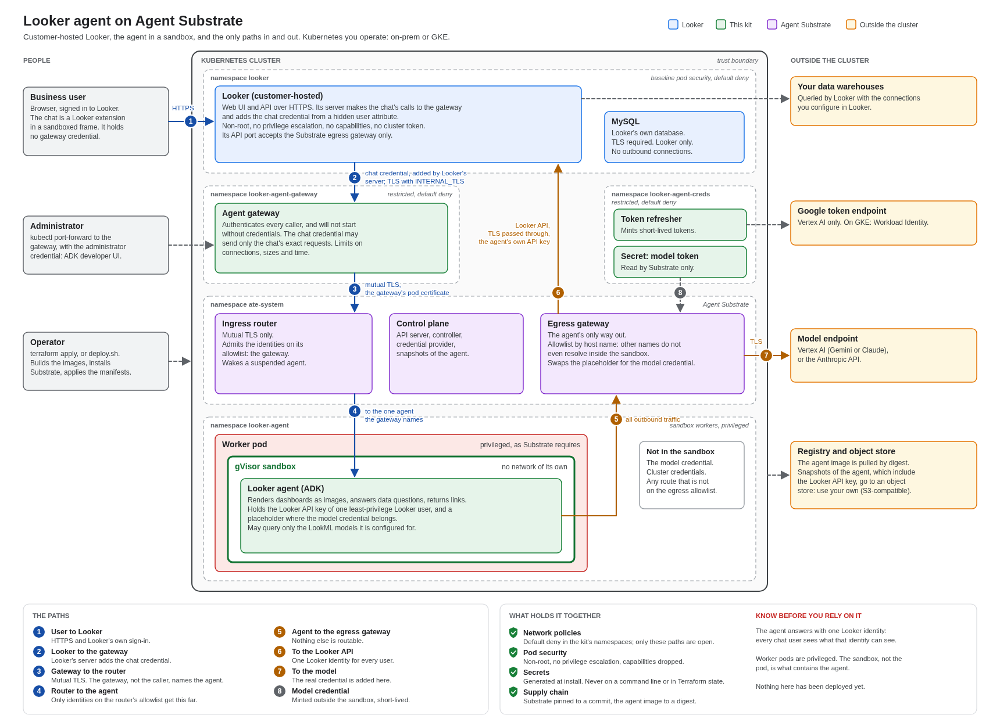

# Looker en tu propia infraestructura + el agente de Looker en Agent Substrate

**Idioma / Language:** [English](README.md) | Español

Este kit toma un agente de analítica para Looker diseñado originalmente para Vertex AI Agent Engine y Gemini Enterprise, y lo ejecuta en un clúster de Kubernetes que tú operas: un Looker alojado por el cliente, el agente ejecutándose como una carga aislada en [Agent Substrate](https://github.com/agent-substrate/substrate) y un chat con el agente integrado dentro de Looker. Apunta primero a Kubernetes fuera de Google Cloud (`PLATFORM="onprem"`) y en segundo lugar a GKE (`PLATFORM="gke"`).

El agente responde preguntas sobre datos de Looker en lenguaje natural. Renderiza dashboards, Looks y gráficos ad hoc como imágenes, responde preguntas de datos con las cifras exactas y devuelve enlaces al contenido dentro de Looker.

## Cuatro aspectos que condicionan el despliegue

**1. Agent Substrate no tiene una instalación soportada fuera de GKE.** Su instalador, `ate-setup`, tiene dos perfiles en la versión v1.0.0. El perfil por defecto es para GKE: guarda los snapshots en Cloud Storage y se niega a ejecutarse sin una cuenta de servicio de Google. El otro, `--kind`, está pensado para clústeres locales de desarrollo y es el único que utiliza un almacén compatible con S3 y ningún servicio en la nube. El código fuente del instalador lo dice claramente: «ate-setup installs GCS everywhere but kind, which uses S3». Por ello, en entornos on-prem, `deploy.sh` apunta el perfil `--kind` a tu clúster. Eso conlleva valores por defecto propios de desarrollo:

- Un almacén de objetos `rustfs` integrado con un volumen de 1Gi. Por defecto (`BUNDLED_STORE_GENERATED_LOGIN="true"`), `deploy.sh` espera a que termine y elimina `job/rustfs-bucket-init`, cambia `deployment/rustfs` a una estrategia de despliegue `Recreate` (evitando bloqueos de montaje múltiple en PVC RWO) y reemplaza sus credenciales por defecto publicadas por credenciales generadas al instalar (sin probar contra un pod real de `rustfs`). Configura `SNAPSHOT_STORE="s3"` para usar tu propio almacén de objetos HTTPS; en ese caso `deploy.sh` parchea los dos sidecars de almacenamiento de objetos de Substrate (montando `EXTRA_CA_FILE` como `AWS_CA_BUNDLE` si está definido), elimina `job/rustfs-bucket-init` y escala `rustfs` a cero, lo cual es una adición de este kit y no algo documentado por Substrate.
- Un volumen de base de datos de 1Gi, registro en modo debug en el agente de nodo y un colector de OpenTelemetry, Jaeger y Prometheus en su propio namespace (`otel-system`, sin autenticación).
- Sin credenciales de registro para las imágenes del agente. El clúster debe poder descargar la imagen del agente **sin credenciales**. (Mantén la imagen licenciada de Looker en un `LOOKER_REGISTRY` separado con `LOOKER_IMAGE_PULL_SECRET`.)

Por todo esto, `deploy.sh` no instalará Substrate en on-prem hasta que establezcas `ONPREM_DEV_PROFILE_ACCEPTED="true"` en `config.env`. Trata el camino on-prem como una prueba de concepto hasta que el proyecto Substrate publique un perfil oficial para on-prem. Vale la pena consultarlo con ellos en el [grupo ate-dev](https://groups.google.com/g/ate-dev).

**2. El clúster necesita dos APIs de Kubernetes desactivadas por defecto.** Substrate identifica cada componente mediante certificados de pod. Necesita `PodCertificateRequest` y `ClusterTrustBundle`, que no están habilitadas por defecto en Kubernetes 1.36. El administrador del clúster debe activar tres feature gates y un grupo de APIs en el API server y en los kubelets (el paso 0 imprime las banderas exactas). Una distribución administrada podría no permitirlo. GKE las ofrece a partir de la versión 1.37.

**3. El repositorio de referencia de Looker está desactualizado.** [looker-hosting-reference-implementations](https://github.com/GoogleCloudPlatform/looker-hosting-reference-implementations) se modificó por última vez en junio de 2023. Su imagen instala OpenJDK 11; la guía de instalación actual de Looker exige OpenJDK 21 (a partir de Looker 26.4). Su Helm chart depende de Secret Manager, Cloud SQL proxy y Filestore, y su Terraform fija versiones de módulos de esa época (por ejemplo `terraform-google-modules/kubernetes-engine` 23.1.0), que no se probaron con los proveedores actuales. Sirvió de modelo para la imagen y los manifiestos aquí incluidos, pero sus archivos no se utilizan:

- `looker/Dockerfile` y `looker/bin/looker.sh` son nuevos, con el JDK y las opciones de JVM del script actual `looker21` de Looker.
- Los manifiestos de Looker son Kubernetes estándar, por lo que los mismos funcionan en on-prem y en GKE.
- No hay Terraform para Looker (Google Cloud core): ese es el producto administrado, que aquí se sustituye por un Looker alojado por el cliente.

**4. La clave API de Looker sigue viviendo dentro del agente.** El modelo de Substrate consiste en mantener las credenciales fuera del sandbox: el agente envía una cabecera de marcador y el egress gateway la reemplaza por el valor real. Eso funciona para la credencial del modelo y el kit lo aplica. No funciona para Looker, cuyo inicio de sesión recibe la clave en el cuerpo de la petición, que el gateway no puede reescribir. Por lo tanto, la clave permanece en el entorno del agente —como ocurría en Agent Engine— y, en consecuencia, en el template almacenado y en los snapshots. Usa un usuario dedicado de Looker con el rol mínimo necesario, restringe el acceso al almacenamiento de Substrate y consulta [docs/security.md](docs/security.md) para el aislamiento de nodos (`WORKER_NODE_SELECTOR`) y los límites de gestión de secretos.

## Cómo encajan las piezas



También disponible como gráfico vectorial escalable: [docs/architecture.svg](docs/architecture.svg). Consulta [Modelo y controles de seguridad](docs/security.md) para el aislamiento por namespaces, niveles de Pod Security, reglas `NetworkPolicy` de denegación por defecto, opciones de TLS, `SECURITY_MODE="strict"` y riesgos heredados de Substrate.

Tres términos de Substrate aparecen en todo el repositorio. Un **actor** es una instancia en ejecución del agente, que Substrate puede suspender a almacenamiento y despertar en la siguiente petición. Un **atespace** es el límite de aislamiento al que pertenece un actor. Un **worker pool** es el conjunto de pods preparados donde se ejecutan los actores.

## El chat dentro de Looker

Los usuarios interactúan con el agente desde una página de chat dentro de Looker, implementada como una *extensión* de Looker. [looker-extension/README.md](looker-extension/README.md) contiene los detalles, los pasos de instalación y qué verificar primero. En resumen:

- **El chat usa un componente existente, no uno nuevo.** Una búsqueda en GitHub en noviembre de 2026 no encontró ninguna extensión de Looker lista para conversar con un agente ADK. El chat utiliza [deep-chat](https://github.com/OvidijusParsiunas/deep-chat) 2.5.1, un componente web con licencia MIT, sin modificaciones. Alrededor de 1,300 líneas de código nuevo (`src/`, 1,407 líneas contando cabeceras de licencia) lo conectan con Looker y con el gateway, endurecen el manejo de Markdown y enlaces, y aplican límites a los artefactos.
- **No se ha ejecutado dentro de Looker ni se ha compilado su bundle.** Su código está probado contra simuladores y contra el gateway real.
- **El chat tiene su propia credencial de gateway más restringida.** El servidor HTTP del agente es el de ADK, que también expone una API de desarrollador: sesiones de todos los usuarios, trazas y evaluaciones. Como una credencial almacenada en Looker está al alcance de cualquier usuario del chat, el gateway restringe la del chat únicamente a iniciar y consultar turnos del agente y descargar sus imágenes. La credencial de administrador se queda contigo.
- **Los enlaces se abren como el usuario lector, no con sesión de usuario embebido.** Por defecto (`LOOKER_LINK_MODE="plain"`), el agente genera URLs normales de Looker (`/dashboards/...`, `/looks/...`, `/explore/...`) y nunca llama a `create_sso_embed_url`. Si activas `LOOKER_LINK_MODE="signed"`, Looker firma los enlaces embebidos con `force_logout_login=true`, por lo que `src/links.js` extrae igualmente la ruta destino y la abre con la sesión del lector. `src/markdown.js` desactiva las imágenes Markdown remotas y filtra cada enlace a través de `src/links.js` antes de que `deep-chat` convierta Markdown en HTML.
- **El agente responde con sus propios permisos de Looker, no con los de quien pregunta.** Esto ya ocurría en Agent Engine, pero dentro de Looker es más fácil pasarlo por alto: cualquiera que pueda abrir el chat ve los datos a los que tiene acceso el usuario API del agente.

## Qué contiene el kit

| Ruta | Descripción |
| :--- | :--- |
| `deploy.sh` | Script de despliegue: pasos numerados en orden, ampliamente comentados. |
| `config.env.example` | Todas las opciones de configuración con comentarios. Cópialo a `config.env`. |
| `terraform/` | Interfaz opcional de Terraform que envuelve los pasos de `deploy.sh` con variables tipadas y sin secretos en el estado. Consulta [terraform/README.md](terraform/README.md). |
| `agent/agents/looker_app/agent.py` | El agente original de Agent Engine, con seis mejoras acotadas de seguridad y aislamiento (ver [más abajo](#qué-cambió-respecto-al-script-de-agent-engine)). |
| `agent/server.py`, `agent/Dockerfile`, `agent/requirements.lock` | Sirve el agente en un contenedor sin privilegios con `/app` de solo lectura, la interfaz de desarrollador de ADK desactivada por defecto y archivo opcional de bloqueo `--require-hashes`. |
| `gateway/gateway.py` | Puerta de entrada al agente. Python de biblioteca estándar, montado desde un ConfigMap inmutable con hash en `looker-agent-gateway`, que aplica autenticación, confinamiento de peticiones de chat, validación contra contrabando HTTP y TLS opcional. |
| `looker-extension/` | El chat dentro de Looker: deep-chat, Looker Extension SDK y el código endurecido que los integra. |
| `looker/` | Dockerfile (repositorio apt firmado de Chrome, envoltorio opcional de sandbox para Chromium, OpenSSL) y script de arranque para un Looker actual alojado por el cliente. |
| `docs/security.md`, `docs/architecture.svg`, `docs/architecture.png` | Modelo de seguridad, límites de confianza, validaciones del modo estricto, lista de verificación en clúster real y diagrama de arquitectura. |
| `tests/` | Todo lo que puede verificarse sin un clúster. `tests/run_local_checks.sh` ejecuta toda la batería. |
| `.github/workflows/checks.yml` | Ejecuta las pruebas locales, compila el bundle de la extensión (`--ignore-scripts`) y ejecuta `terraform fmt -check` + `terraform validate` cuando se lanza manualmente (acciones fijadas por SHA de commit). Aún no ejecutado. |
| `README.md`, `README.es.md` | Documentación en inglés ([English](README.md)) y español. |
| `LICENSE`, `CONTRIBUTING.md`, `SECURITY.md` | Licencia Apache 2.0, guía de contribución y cómo reportar problemas de seguridad. |

## Antes de empezar

| | On-prem | GKE |
| :--- | :--- | :--- |
| Clúster | El tuyo, con las dos APIs de certificados, un StorageClass por defecto y un plugin de red que haga cumplir `NetworkPolicy` | Creado por el script (GKE 1.37, canal Rapid) |
| Tus permisos | cluster-admin | Owner en el proyecto (o Editor más Role Admin y Project IAM Admin, para crear el rol personalizado de Vertex y los enlaces IAM) |
| Herramientas locales | `kubectl`, `go` (Substrate v1.0.0 solicita la toolchain 1.27.3; un Go anterior debe poder descargarla), `git`, `docker`, `jq`, `openssl`, `curl`. Opcional: `terraform` 1.5+. Para la extensión: Node.js 18+ con npm y acceso a un registro npm. | Las mismas, más `gcloud` con Application Default Credentials |
| Registro de imágenes | Uno desde el que los nodos del agente puedan descargar la imagen del agente sin credenciales (usa `LOOKER_REGISTRY` + `LOOKER_IMAGE_PULL_SECRET` para Looker) | Artifact Registry, creado por el script |
| Looker | Una clave de licencia y el EULA aceptado en [download.looker.com/validate](https://download.looker.com/validate) | Lo mismo |
| Modelo | Vertex AI: clave de cuenta de servicio con únicamente `aiplatform.endpoints.predict` (rol personalizado recomendado). O bien una clave API de Anthropic. | Vertex AI mediante Workload Identity con un rol personalizado (`aiplatform.endpoints.predict`) creado por el script, sin clave estática |

El kit separa los componentes en cuatro namespaces: `looker-agent-gateway` (`restricted`), `looker-agent-creds` (`restricted`), `looker` (`baseline`) y `looker-agent` (`privileged`, ya que los pods worker de Substrate necesitan `SYS_ADMIN`, `NET_ADMIN` y un perfil seccomp sin confinar, por lo que `looker-agent` no aloja nada más). Una política de clúster que prohíba pods privilegiados en `looker-agent` bloqueará al agente; configura `WORKER_NODE_SELECTOR` junto con el taint de sandbox de Substrate para mantener los pods worker en nodos dedicados.

## Cómo ejecutarlo

Puedes ejecutar `./deploy.sh` directamente o mediante [Terraform](terraform/README.md). Usar `read -rs` mantiene los secretos fuera del historial del shell:

```bash
cp config.env.example config.env && chmod 600 config.env
# edita config.env (usa SECURITY_MODE="strict" para validación endurecida), luego:
read -rs -p "LOOKER_LICENSE_KEY: " LOOKER_LICENSE_KEY && echo && export LOOKER_LICENSE_KEY
./deploy.sh render                   # opcional: genera todos los manifiestos (secretos redactados) y se detiene
./deploy.sh
```

O con Terraform (`terraform init` funciona sin conexión y no descarga proveedores):

```bash
cd terraform && cp terraform.tfvars.example terraform.tfvars   # edita las variables
terraform init && terraform apply -var render_only=true       # revisa primero los manifiestos
read -rs -p "LOOKER_LICENSE_KEY: " LOOKER_LICENSE_KEY && echo && export LOOKER_LICENSE_KEY
terraform apply
```

Si `./deploy.sh` responde «Permission denied», el archivo perdió su bit de ejecución en el camino (por ejemplo, al subir archivos por la interfaz web de GitHub). Ejecuta `chmod +x deploy.sh` una vez o lánzalo con `bash deploy.sh`.

Con un Looker nuevo, la primera ejecución **se detiene tras instalar Looker y Substrate, con código de salida 2**. El agente necesita credenciales API de Looker y estas no pueden existir hasta que Looker esté activo. El script muestra qué hacer: iniciar sesión, conectar una base de datos y un proyecto LookML, crear un usuario API dedicado (no administrador) con solo el conjunto de modelos y permisos necesarios (y eliminar `looker-provision` una vez iniciada la sesión). Activa Embed SSO solo si cambias a `LOOKER_LINK_MODE="signed"`. Después:

```bash
# configura LOOKER_CLIENT_ID en config.env (o terraform.tfvars)
read -rs -p "LOOKER_CLIENT_SECRET: " LOOKER_CLIENT_SECRET && echo && export LOOKER_CLIENT_SECRET
./deploy.sh
```

La segunda ejecución construye y publica la imagen del agente por digest, crea el actor y el gateway, verifica la ruta de extremo a extremo y prepara la extensión de Looker. Si ya tienes un Looker existente, establece `DEPLOY_LOOKER="false"` y `LOOKER_API_URL`, y todo se completará en una sola ejecución.

Después, el chat:

```bash
./deploy.sh extension                # escribe .work/looker-extension/, ejecuta npm --ignore-scripts + build
# o ./deploy.sh extension-files      # escribe solo los manifiestos y configuración sin ejecutar npm
```

El script imprime los pasos que realiza un administrador de Looker una sola vez para añadir la extensión. También están detallados en [looker-extension/README.md](looker-extension/README.md).

Los valores en `config.env` prevalecen sobre las variables de entorno, así que no configures un secreto en ambos sitios.

## Qué hace cada paso

| Paso | Qué ocurre |
| :--- | :--- |
| -1 Validar | Rechaza marcadores `YOUR_...`, caracteres de control, campos mal formados, contraseñas de gateway cortas (`<16` caracteres), S3 sin cifrar sin autorización explícita, Ingress sin TLS, compilaciones de Looker que no sean `linux/amd64`, o MySQL 8.4 con Looker `<26.6`. En `SECURITY_MODE="strict"`, rechaza imágenes base o de ejecución sin digest, el almacén integrado, endpoints HTTP planos, salida de Looker a `0.0.0.0/0`, BD externa de Looker con `LOOKER_DB_VERIFY_SSL="false"`, seccomp sin confinar para Looker, NetworkPolicies desactivadas, `ALLOW_KUBECTL_ATE_PROXY="true"`, enlaces embebidos firmados o `AGENT_DEV_UI="true"`. |
| 0 Preflight | Verifica herramientas locales, APIs de certificados y (con `NETWORK_POLICY_CHECK="true"`) ejecuta una sonda TCP en Python (`GATEWAY_IMAGE`) dentro de un namespace temporal `restricted` con `default-deny` (eliminado al salir) para confirmar que el CNI hace cumplir `NetworkPolicy`. |
| 1 Solo GKE | Ejecuta la herramienta de GKE de Substrate (`setup-gcp bootstrap`) para crear el clúster, buckets de snapshots e IAM, y crea/otorga acceso de Artifact Registry para `REGISTRY` (y para un `LOOKER_REGISTRY` separado si está configurado). |
| 2 Looker | Descarga los JARs de Looker (limpiando si falla), construye `looker/Dockerfile` (`LOOKER_BASE_IMAGE`, `google-chrome-stable` desde repositorio apt firmado, envoltorio opcional con `--no-sandbox`), despliega MySQL 8.4 (`caching_sha2_password`, `--require-secure-transport=ON`, sondas `--ssl-mode=REQUIRED`) y Looker (`--internal-db-creds=/run/looker-db/looker-db.yml` montado desde el Secret `looker-db-creds` con `ssl: true` y `LOOKER_DB_VERIFY_SSL` configurable, `LOOKER_HEAP_PERCENT`, y opcionalmente `INTERNAL_TLS="private-ca"` con keystore/truststore y `/tmp` en memoria). Crea la clave de cifrado de Looker una sola vez. |
| 3 Substrate | Descarga `v1.0.0`, verifica `SUBSTRATE_COMMIT` y ejecuta `ate-setup` con sandboxes gVisor, admitiendo en el router solo `GATEWAY_NAMESPACE` (y `kubectl ate proxy` únicamente si `ALLOW_KUBECTL_ATE_PROXY="true"`); espera y elimina `job/rustfs-bucket-init`, y o bien rota credenciales de `rustfs` con estrategia `Recreate` o configura S3 externo (con `EXTRA_CA_FILE` opcional mediante `AWS_CA_BUNDLE`). |
| 4 Imagen del agente | Construye (`AGENT_BASE_IMAGE`) y publica la imagen del agente fijada por digest `@sha256:` (fijando dependencias con `agent/requirements.lock` si tiene contenido, avisando si está vacío, e incorporando el certificado de `private-ca` / `EXTRA_CA_FILE`). Importa el agente durante la compilación. |
| 5 Actor | Crea el worker pool (con `WORKER_NODE_SELECTOR` opcional), el renovador de tokens (`KUBE_API_PORTS`) y credenciales en `looker-agent-creds`, el rol IAM personalizado mínimo de Vertex en GKE (restaurándolo si estaba en borrado lógico), el template inmutable (eliminando templates obsoletos), el actor y la política de salida (actualizada in situ mediante `kubectl ate update egress-policy` en re-ejecuciones). |
| 6 Gateway | Despliega `gateway.py` desde un ConfigMap inmutable con hash en `looker-agent-gateway` con contraseñas separadas de administrador y chat en archivos `*_FILE` (`0440`), límites configurables de conexiones/trabajos (`GATEWAY_MAX_*`, `GATEWAY_JOB_DEADLINE_SECONDS`), puerto independiente `/healthz` (`HEALTH_PORT=8081`), `NetworkPolicy` de denegación por defecto, TLS 1.2+ opcional e Ingress estricto opcional. |
| 7 Verificar | Confirma que el gateway rechaza llamadas anónimas, reenvía peticiones autenticadas por TLS mutuo al agente y confina la credencial del chat fuera de la API de desarrollador. No llama a Looker ni al modelo. |
| 8 Extensión | Escribe el proyecto de extensión (incluyendo `EXTENSION_ALLOWED_LINK_ORIGINS` opcional y `use_downloads` solo cuando `EXTENSION_ALLOW_DOWNLOADS="true"`) en `.work/looker-extension/`. `./deploy.sh extension` ejecuta `npm install --ignore-scripts`, pruebas y compilación del bundle; `./deploy.sh extension-files` escribe únicamente la configuración y los archivos LookML. |

## Qué se verificó y qué no

`tests/run_local_checks.sh` vuelve a ejecutar cada verificación de esta tabla. Pasó las 19 comprobaciones localmente (`All local checks passed`).

En GitHub, el flujo «Checks» ejecuta el mismo script, compila el bundle de la extensión (`npm ci/install --ignore-scripts`) y ejecuta `terraform fmt -check` + `terraform validate`. Solo se inicia manualmente desde la pestaña Actions y todavía no se ha ejecutado.

| Componente | Cómo se verificó | Resultado |
| :--- | :--- | :--- |
| Gateway | 98 pruebas (`gateway/test_gateway.py`), la mayoría sobre TLS mutuo real contra un router simulado: autenticación, `MIN_PASSWORD_LENGTH=16`, carga de archivos `*_FILE`, higiene de cabeceras de enrutamiento y suplantación, validación estricta de rutas y JSON en modo chat, rechazo de eco de credenciales, pruebas contra contrabando de cabeceras HTTP, cuerpos chunked/prefijados, comprobaciones CSRF/Origin, exigencia `415` de Content-Type, límites de concurrencia/trabajos, TLS 1.2+ por hilo con rotación, puerto `/healthz` separado, streaming y redacción de logs. | Aprobado |
| Extensión de Looker | 98 pruebas unitarias (`looker-extension/test/*.test.js`) contra simuladores de Looker, del gateway, del renderizador de chat y del agente, más 15 pruebas (`tests/extension_gateway_test.py`) ejecutando el código de la extensión contra el gateway real por HTTP y TLS mutuo (incluyendo rechazos estrictos del modo chat, IDs LookML con `::` y validación de artefactos). | Aprobado |
| Entrada y herramientas del agente | 23 pruebas de arranque (`agent/test_server.py`: bundle CA, simulador de metadatos, SIGTERM) + 22 pruebas de envoltorios de herramientas (`agent/test_agent_tools.py`: `LOOKER_LINK_MODE`, lista permitida `LOOKER_MODELS`, validación de formatos de id/modelo/explore, acotación de `limit`, ejecución sin bloqueo del bucle de eventos, mensajes de error resumidos y firma `ORIGINAL_INSTRUCTION_SHA256`). | Aprobado |
| Objetos Substrate y manifiestos K8s | `tests/check_rendered.py` valida cada `ActorTemplate`, `EgressPolicy` y `WorkerPool` generado contra `ateapi.proto` y el esquema CRD de Substrate v1.0.0, además de verificar niveles Pod Security de namespaces, puertos/namespaces de `NetworkPolicy`, TLS en Ingress, contextos de seguridad sin root y selectores de nodo en 5 configuraciones (`onprem`, `external`, `gke`, `full`, `strict`). Cinco errores inyectados fueron detectados. | Aprobado |
| Lógica de `deploy.sh` | 81 comprobaciones de funciones individuales (`tests/deploy_functions_test.sh`, incluyendo generación real de certificados/SANs con `openssl` en modo `private-ca`, parche S3 con `EXTRA_CA_FILE`, parche `Recreate` de `rustfs` y creación/reemplazo de Secrets) y 283 comprobaciones de ejecución simulada de extremo a extremo (`tests/deploy_dry_run_test.sh`, incluyendo montaje de Secret `looker-db.yml` con contraseñas con caracteres especiales, sondas MySQL `--ssl-mode=REQUIRED`, `INTERNAL_TLS="private-ca"`, sondas Python de `NETWORK_POLICY_CHECK`, rechazo de `SECURITY_MODE="strict"`, recuperación de `LOOKER_REGISTRY` y rol en borrado lógico en GKE, actualización in situ `update egress-policy` y cero fugas de secretos). | Aprobado |
| Keystore `private-ca` y sondas Python | Los comandos exactos `openssl pkcs12 -export -name 1` + JDK `keytool -importkeystore` + `keytool -importcert` de `prepare-tls` ejecutados localmente con OpenSSL 3.6.5 y JDK `keytool`; los comandos Python TCP servidor/cliente de `NETWORK_POLICY_CHECK` verificados localmente en loopback. | Aprobado |
| Interfaz Terraform | Verificación de formato HCL (`hclfmt -require-no-change`) y 97 comprobaciones automatizadas (`tests/terraform_check.py`) que comparan `variables.tf`/`main.tf` contra cada ajuste y paso de `deploy.sh`, verifican que los patrones `fileset()` eviten `/` dentro de `{...}` y coincidan con archivos reales, confirman que ningún secreto entra en Terraform y renderizan con el entorno de ejemplo. | Aprobado |

**No verificado, porque requiere el entorno real:**

- Que `ate-setup --kind` funcione en un clúster que no sea kind, con imágenes publicadas.
- Que el parche S3 y `BUNDLED_STORE_GENERATED_LOGIN="true"` dejen a Substrate (`rustfs`) operativo tras reiniciarse.
- Que `NETWORK_POLICY_CHECK` y los manifiestos `NetworkPolicy` del kit apliquen efectivamente los límites de red bajo el CNI de tu clúster.
- Que `INTERNAL_TLS="private-ca"` funcione de extremo a extremo dentro del keystore/truststore Java de Looker (`looker` + `looker-api` + gateway HTTPS) y dentro del contenedor del agente (`LOOKERSDK_VERIFY_SSL="true"`).
- Que la imagen del agente compile (`requirements.txt` o `requirements.lock`) y arranque limpiamente dentro de un sandbox gVisor sin red para su primer snapshot.
- Que LiteLLM, google-genai y el SDK de Anthropic acepten el servidor simulado de metadatos y envíen una cabecera que el gateway pueda sustituir. El simulador se probó con formas de petición, no contra esas bibliotecas.
- Que el bundle de la extensión compile con npm, que Looker lo cargue bajo su CSP y que `deep-chat` + el hook `window.remarkable_plugins` en `src/markdown.js` rendericen y filtren enlaces e imágenes en un navegador real.
- Cómo se comportan realmente los dos proxies de Looker: si su servidor llama a una dirección interna HTTP plano o con CA privada, cuánto espera y cómo envía los cuerpos de las peticiones.
- Que la API de ADK devuelva exactamente lo que indica su código fuente. El código revisado corresponde a google-adk 2.14 y 2.15; la imagen del agente instala la versión que resuelva `requirements.txt` salvo que se fije en `requirements.lock`.
- Que la imagen de Looker compile y funcione: el JDK, la versión de Chrome necesaria para renderizar (especialmente bajo `LOOKER_SECCOMP_PROFILE="RuntimeDefault"` + `LOOKER_CHROMIUM_NO_SANDBOX="true"`), MySQL 8.4 con `caching_sha2_password` y TLS (`ssl: true`), y el dialecto `mysql_8`.
- Toda la ruta de GKE, incluido el rol personalizado de Vertex de un solo permiso (`aiplatform.endpoints.predict`) con Workload Identity.
- `terraform validate`, `terraform plan` y `terraform apply` contra un binario real de `terraform`.
- El comportamiento real de cualquiera de las herramientas simuladas. Las ejecuciones simuladas verifican la lógica del script, no cómo responden las herramientas reales del clúster.

## Qué verificar primero en un clúster real

En este orden; cada paso bloquea los siguientes.

1. `./deploy.sh preflight`. Si faltan las APIs de certificados, detente aquí y habla con el equipo que administra el clúster.
2. `./deploy.sh substrate`. Revisa el informe de ajustes que imprime el instalador. Este es el paso con mayor incertidumbre en on-prem.
3. `./deploy.sh image && ./deploy.sh agent`. Si falla el primer snapshot del template, el script imprime el error de Substrate. La causa habitual es que la imagen intenta conectarse a la red al arrancar.
4. Hazle al agente una pregunta que solo use el modelo, desde la interfaz de desarrollador (el script indica cómo abrirla). Si falla, busca rechazos con `kubectl -n ate-system logs deployment/atenet-egress -c ext-proc | grep 'egress denied'`.
5. Pide datos y luego la imagen de un dashboard.
6. Si no fluye tráfico entre los sandboxes y el egress gateway: el script de clúster del propio Substrate configura `net.ipv4.conf.all.proxy_arp=1` en sus nodos. Tus nodos podrían necesitar lo mismo. Se desconoce si eso es exclusivo de kind.
7. Solo entonces configura el chat dentro de Looker: `./deploy.sh extension` y la lista en [looker-extension/README.md](looker-extension/README.md#check-these-first). Verificar primero el agente garantiza que un fallo aquí corresponde a Looker o la extensión, no al agente.

## Operación

- **El agente no se suspende solo.** Substrate suspende un actor únicamente cuando se le solicita. Para liberar su worker: `kubectl ate suspend actor looker-agent -a looker-agent --mode=sync`. La siguiente petición lo despierta conservando las sesiones de chat.
- **Antes de drenar un nodo, suspende el actor.** Un actor que sigue en ejecución cuando se elimina su pod worker pierde todo lo ocurrido desde su último snapshot.
- **Cambiar un ajuste o rotar la clave de Looker:** edita `config.env` y vuelve a ejecutar el script. Los templates son inmutables, por lo que el script crea uno nuevo, mueve el actor a él y elimina los templates obsoletos. El actor arranca en frío y se pierden las sesiones de chat abiertas. Al rotar `LOOKER_CLIENT_SECRET`, revoca o elimina también la clave antigua en Looker.
- **Elimina el Secret de aprovisionamiento tras el primer inicio de sesión:** una vez Looker esté activo y exista tu cuenta de administrador, ejecuta `kubectl -n looker delete secret looker-provision`.
- **Haz copia de seguridad de la clave de cifrado de Looker** en el Secret `looker/looker-secrets`. Sin ella no se puede leer la base de datos de Looker.
- **Protege el RBAC en `GATEWAY_NAMESPACE` (`looker-agent-gateway`):** cualquier identidad autorizada para crear pods u objetos `PodCertificateRequest` en ese namespace puede obtener la identidad SPIFFE del gateway admitida por el router.
- **Un único actor atiende a todos los usuarios**, detrás de dos contraseñas compartidas (mínimo 16 caracteres): la del administrador (Secret `looker-agent-gateway/looker-agent-gateway-auth`) y la del chat (`looker-agent-gateway/looker-agent-gateway-chat-auth`). No están implementados actores por usuario ni inicio de sesión individual.
- **Rotar la contraseña del chat:** ejecuta `read -rs -p "GATEWAY_CHAT_AUTH_PASSWORD: " GATEWAY_CHAT_AUTH_PASSWORD && echo && export GATEWAY_CHAT_AUTH_PASSWORD`, corre `./deploy.sh gateway` y actualiza el nuevo valor en el atributo de usuario de Looker. Mientras tanto, el chat responderá «refused the request».
- **Mantén el gateway con una sola réplica.** Las preguntas en curso y los tokens del navegador viven en su memoria. Un reinicio los pierde y el chat pedirá a los usuarios volver a preguntar.
- **La desinstalación no está automatizada de forma deliberada:** eliminar los manifiestos de Looker borra el volumen de archivos de Looker. `.work/rendered/` conserva todo lo que se aplicó y `ate-setup delete ate-system` desinstala Substrate.

## Gemini Enterprise

No está conectado. Registrar este agente implicaría tres cosas que el kit no implementa:

1. Exponerlo sobre A2A. ADK lo soporta (`a2a=True` más un archivo agent card); `server.py` no lo activa.
2. Un endpoint HTTPS accesible desde Gemini Enterprise con un método de autenticación que este pueda presentar. La contraseña del gateway no cumple ese requisito. En on-prem implicaría exponer el agente a internet.
3. Registro mediante URL de agent card. La llamada `provisioned_reasoning_engine` que usaba el script de Agent Engine es exclusiva de Agent Engine.

Tampoco está confirmado que Gemini Enterprise muestre imágenes en línea para un agente A2A igual que con artefactos de Agent Engine, que fue la razón original del diseño con artefactos. Verifica ese punto antes de implementarlo.

## Qué cambió respecto al script de Agent Engine

El agente procede de un único script de configuración que lo desplegaba en Vertex AI Agent Engine y lo registraba en Gemini Enterprise. Ese script no forma parte de este kit. Esta sección es para quienes lo conocen.

| Script de Agent Engine | Este kit | Motivo |
| :--- | :--- | :--- |
| `agent_engines.create(...)` | Imagen de contenedor servida por `agent/server.py` | Substrate ejecuta contenedores |
| Registro en Gemini Enterprise | Un chat dentro de Looker (extensión). La UI web de ADK sigue disponible vía `AGENT_DEV_UI` / `kubectl port-forward`. | El agente se utiliza desde Looker; consulta arriba respecto a Gemini Enterprise |
| Credencial del modelo desde la cuenta de servicio del runtime | Marcador en el agente, token real inyectado en el egress | Substrate mantiene las credenciales fuera del sandbox |
| `LOOKER_HOST` tomado de `LOOKERSDK_BASE_URL` | `LOOKER_PUBLIC_URL` si está configurado | El agente contacta a Looker mediante un nombre interno del clúster que el navegador no puede abrir |
| Enlaces embebidos firmados (`force_logout_login=true`) | `LOOKER_LINK_MODE="plain"` por defecto (`"signed"` conserva enlaces embebidos); la instrucción coincide con el modo | Dentro de Looker, abrir un enlace embebido firmado reemplaza la sesión del propio usuario; `"plain"` evita llamar a `create_sso_embed_url` |
| `LOOKER_MODELS` aplicado solo en enlaces firmados | Aplicado en todas las herramientas que aceptan un modelo y filtra `list_looker_models` | Evita que inyecciones de prompt o conjeturas del modelo consulten modelos LookML no configurados |
| Entradas modelo/id/explore/limit sin validar y llamadas SDK bloqueantes | `_guarded` valida identificadores, acota `limit` a `1..500`, ejecuta el SDK de Looker vía `asyncio.to_thread` / `asyncio.sleep` y resume errores con `_brief` | Rechaza identificadores inválidos, evita que un render lento bloquee otras peticiones y evita filtrar URLs internas o trazas completas |
| `google-cloud-aiplatform[agent_engines,adk]` | Eliminado | No se usa fuera de Agent Engine |

El resto del prompt y de las definiciones de herramientas permanece fiel al original (`agent/test_agent_tools.py` verifica `ORIGINAL_INSTRUCTION_SHA256` cuando `LOOKER_LINK_MODE="signed"`).

## Fuentes consultadas

Leídas directamente, no mediante resúmenes de búsqueda:

- Substrate v1.0.0: `README.md`, `docs/guides/operator-install.md`, `docs/reference/api-guide.md`, `docs/reference/kubectl-ate.md`, las guías de egress, `api/ateapi/v1/ateapi.proto`, el código fuente del instalador en `cmd/ate-setup` y los manifiestos en `manifests/ate-install`.
- [substrate-gke](https://github.com/ai-on-gke/substrate-gke) en el commit `0de8201`: `README.md`, `docs/manual-gke-setup.md`, `tools/setup-gcp/README.md`.
- looker-hosting-reference-implementations en el commit `ac9ad4d`: tutoriales, Helm chart, Dockerfile y Terraform de Kubernetes.
- Documentación de Looker: instalación de la aplicación Looker, migración de la base de datos interna a MySQL, auto-aprovisionamiento de una instancia nueva, script de arranque `looker21`, páginas del framework de extensiones (parámetro `application`, ejemplos de código, ajustes de administración), atributos de usuario e inserción firmada.
- Extension SDK de Looker: su README y el código fuente de la API de host (`extension_host_api.ts`), y la plantilla `vanilla-javascript` de `create-looker-extension`.
- Código fuente de deep-chat 2.5.1: tipos de manejador, respuesta y estilo, código de peticiones y mensajes, y configuración de Markdown.
- Código fuente de google-auth y ADK, para el protocolo del servidor de metadatos, el punto de entrada del servidor ADK y las rutas y modelos de API usados por la extensión.

## Términos de los productos con los que funciona

Este kit solo es útil junto con productos que tienen sus propios términos. No contiene ninguno de ellos ni modifica ninguno de esos términos.

- **Looker**, y **Vertex AI** si el modelo del agente se ejecuta allí: los [Términos de Servicio de Google Cloud Platform](https://cloud.google.com/terms) y los [Términos Específicos del Servicio](https://cloud.google.com/terms/service-terms), o el acuerdo vigente con Google en su lugar. `deploy.sh` descarga los archivos JAR de Looker con tu propia clave de licencia tras haber aceptado el EULA de Looker en [download.looker.com/validate](https://download.looker.com/validate).
- **Google Chrome**, que la imagen de Looker instala para renderizar dashboards como imágenes: los [Términos de Servicio de Chrome](https://www.google.com/chrome/terms/).
- **La API de Anthropic**, si la eliges como proveedor de modelo: los términos propios de Anthropic.

## Licencia y orígenes

El contenido de este repositorio se distribuye bajo la Licencia Apache, Versión 2.0. Consulta [LICENSE](LICENSE).

El repositorio no incluye copias del proyecto de ningún tercero. Lo que el kit necesita de terceros se descarga al ejecutarlo y se rige por su propia licencia:

| Componente | Descargado por | Licencia |
| :--- | :--- | :--- |
| Agent Substrate v1.0.0, y substrate-gke en GKE | `deploy.sh`, desde GitHub | Apache-2.0 |
| ADK, Looker SDK, LiteLLM, Anthropic SDK y el resto de paquetes en `agent/requirements.txt` | `pip`, al construir la imagen del agente | Cada uno la suya |
| deep-chat 2.5.1, Looker Extension SDK, webpack y webpack-cli | `npm`, al compilar la extensión | MIT para estos cuatro. Sus dependencias mantienen sus propias licencias. |
| Looker | `deploy.sh`, con tu clave de licencia | EULA de Looker |
| Imágenes base, MySQL, Chrome e imágenes publicadas de Substrate | Compilaciones de imagen y el clúster | Cada uno la suya |

Tres archivos se escribieron tomando como modelo un archivo existente:

| Archivo | Modelo | Licencia del modelo |
| :--- | :--- | :--- |
| `looker/Dockerfile` | `builders/dockerfile/Dockerfile` en [looker-hosting-reference-implementations](https://github.com/GoogleCloudPlatform/looker-hosting-reference-implementations) | Apache-2.0, Copyright 2022 Google LLC |
| `looker-extension/webpack.config.cjs` | `templates/vanilla-javascript/webpack.config.js` en [create-looker-extension](https://github.com/looker-open-source/create-looker-extension) | Apache-2.0, Copyright 2021 Google LLC |
| `looker/bin/looker.sh` | `startup_scripts/looker21` en [customer-scripts](https://github.com/looker-open-source/customer-scripts). Nueve líneas provienen de allí: las dos listas de opciones `--add-opens`, la configuración del recolector de basura y las líneas que leen `lookerstart.cfg` y pasan las opciones a `java`. | MIT, Copyright (c) 2015 Looker Data Sciences, Inc. |

## Contribuciones y seguridad

Consulta [CONTRIBUTING.md](CONTRIBUTING.md) para saber cómo contribuir y [SECURITY.md](SECURITY.md) para reportar problemas de seguridad.

La elegibilidad para el [Google Open Source Software Vulnerability Rewards Program](https://bughunters.google.com/open-source-security) se determina conforme a las [Google Open Source Software Vulnerability Reward Program Rules](https://bughunters.google.com/about/rules/open-source/google-open-source-software-vulnerability-reward-program-rules).
