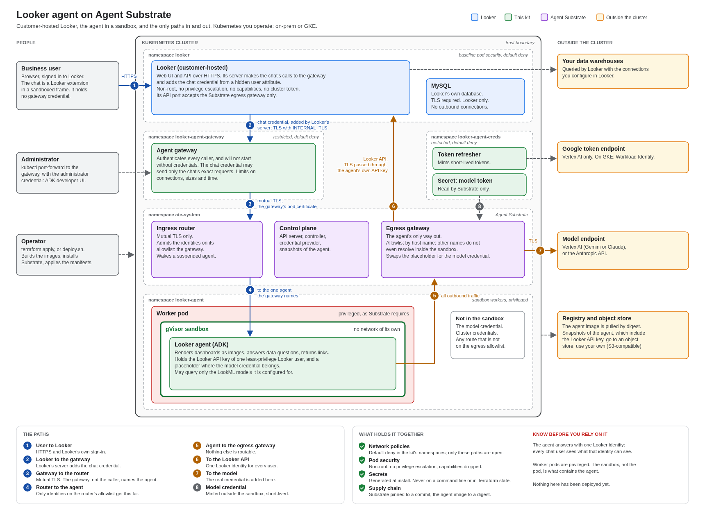

# Looker on your own infrastructure + the Looker agent on Agent Substrate

**Language / Idioma:** English | [Español](README.es.md)

This kit takes a Looker analytics agent that was built for Vertex AI Agent Engine and Gemini Enterprise, and runs it on Kubernetes you operate: a customer-hosted Looker, the agent as a sandboxed workload on [Agent Substrate](https://github.com/agent-substrate/substrate), and a chat with the agent inside Looker. It targets Kubernetes outside Google Cloud first (`PLATFORM="onprem"`) and GKE second (`PLATFORM="gke"`).

The agent answers questions about Looker data in plain language. It renders dashboards, Looks and ad-hoc charts as images, answers data questions with the numbers, and returns links to the content in Looker.

> [!CAUTION]
> **Nothing here has been deployed.** The kit was written without a cluster, a Looker license or a model endpoint to run it against, on a machine without Docker, Go, kubectl, npm or Terraform. Substrate's installer has not been run, neither image has been built, `terraform validate` has not run, and the Looker extension has not been built. The gateway, the agent's entrypoint and tool wrappers, the extension's code, the Terraform variable mapping and the manifest renderer have real local tests. Everything else was written from the Substrate v1.0.0 and Looker documentation and source, and checked for syntax, structure and control flow only. See [What was checked and what was not](#what-was-checked-and-what-was-not).

This project is intended for demonstration purposes only. It is not intended for use in a production environment.

## Four things that change the plan

**1. Agent Substrate has no supported install outside GKE.** Its installer, `ate-setup`, has two profiles in v1.0.0. The default is for GKE: it stores snapshots in Cloud Storage and refuses to run without a Google service account. The other, `--kind`, is for local development clusters, and is the only one that uses an S3-compatible store and no cloud services. The installer source says it plainly: "ate-setup installs GCS everywhere but kind, which uses S3." So on-prem, `deploy.sh` points the `--kind` profile at your cluster. That brings development defaults with it:

- A bundled `rustfs` object store with a 1Gi volume. By default (`BUNDLED_STORE_GENERATED_LOGIN="true"`), `deploy.sh` waits for and deletes `job/rustfs-bucket-init`, switches `deployment/rustfs` to a `Recreate` rollout strategy (avoiding RWO PVC multi-attach deadlocks), and replaces its published default login with generated credentials on install (untested against a live `rustfs` pod). Set `SNAPSHOT_STORE="s3"` to use your own HTTPS object store; `deploy.sh` then patches Substrate's two object-store sidecars (mounting `EXTRA_CA_FILE` as `AWS_CA_BUNDLE` if set), deletes `job/rustfs-bucket-init`, and scales `rustfs` to zero, which is this kit's addition and not something Substrate documents.
- A 1Gi database volume, debug logging on the node agent, and an OpenTelemetry collector, Jaeger and Prometheus in a namespace of their own (`otel-system`, unauthenticated).
- No registry login for agent images. The cluster must be able to pull the agent image **without credentials**. (Keep Looker's licensed image in a separate `LOOKER_REGISTRY` with `LOOKER_IMAGE_PULL_SECRET`.)

Because of all this, `deploy.sh` will not install Substrate on-prem until you set `ONPREM_DEV_PROFILE_ACCEPTED="true"` in `config.env`. Treat the on-prem path as a proof of concept until the Substrate project ships an on-prem profile. It is worth asking them: the project lists the [ate-dev group](https://groups.google.com/g/ate-dev) for this.

**2. The cluster needs two Kubernetes APIs that are off by default.** Substrate identifies every component with pod certificates. It needs `PodCertificateRequest` and `ClusterTrustBundle`, which are not enabled by default as of Kubernetes 1.36. The cluster administrator has to turn on three feature gates and one API group on the API server and kubelets (step 0 prints the exact flags). A managed distribution may not let you. GKE serves them from 1.37.

**3. The Looker reference repository is out of date.** [looker-hosting-reference-implementations](https://github.com/GoogleCloudPlatform/looker-hosting-reference-implementations) was last changed in June 2023. Its image installs OpenJDK 11; Looker's install guide now requires OpenJDK 21 (from Looker 26.4). Its Helm chart depends on Secret Manager, the Cloud SQL proxy and Filestore, and its Terraform pins module versions from that time (for example `terraform-google-modules/kubernetes-engine` 23.1.0), which were not tried against current providers. It was the model for the image and the manifests here, but its files are not used:

- `looker/Dockerfile` and `looker/bin/looker.sh` are new, with the JDK and JVM flags from Looker's current `looker21` startup script.
- The Looker manifests are plain Kubernetes, so the same ones work on-prem and on GKE.
- There is no Terraform for Looker (Google Cloud core): that is the managed product, which a customer-hosted Looker replaces.

**4. The Looker API key still lives inside the agent.** Substrate's model is that credentials stay out of the sandbox: the agent sends a placeholder header and the egress gateway swaps in the real value. That works for the model credential and the kit does it. It does not work for Looker, whose login takes the key in the request body, which the gateway cannot rewrite. So the key is in the agent's environment, as it was on Agent Engine, and therefore in the stored template and in snapshots. Use a dedicated Looker user with the narrowest role that works, restrict access to Substrate storage, and see [docs/security.md](docs/security.md) for node isolation (`WORKER_NODE_SELECTOR`) and secret-management limits.

## How it fits together



Also available as a scalable vector graphic: [docs/architecture.svg](docs/architecture.svg). See [Security model and controls](docs/security.md) for namespace isolation, Pod Security levels, default-deny `NetworkPolicy` rules, TLS options, `SECURITY_MODE="strict"`, and inherited Substrate risks.

Three Substrate terms appear throughout. An **actor** is one running instance of the agent, which Substrate can suspend to storage and wake on the next request. An **atespace** is the isolation boundary an actor belongs to. A **worker pool** is the set of warm pods actors run on.

## The chat inside Looker

People use the agent from a chat page inside Looker, a Looker *extension*. [looker-extension/README.md](looker-extension/README.md) has the details, the install steps and what to check first. The short version:

- **The chat is an existing component, not a new one.** A search of GitHub in November 2026 found no ready-made Looker extension that chats with an ADK agent. The chat is [deep-chat](https://github.com/OvidijusParsiunas/deep-chat) 2.5.1, an MIT-licensed web component, used unchanged. About 1,300 lines of new code (`src/`, 1,407 lines including license headers) connect it to Looker and to the gateway, harden markdown and link handling, and enforce artifact bounds.
- **It has not run inside Looker, and its bundle has not been built.** Its code is tested against stand-ins and against the real gateway.
- **The chat has its own, weaker gateway credential.** The agent's HTTP server is ADK's, which also serves a developer API: everyone's sessions, traces, evals. A credential stored in Looker is within reach of every chat user, so the gateway confines the chat's to starting and polling agent turns and fetching their images. The administrator's credential stays with you.
- **Links are opened as the reader, not signed-in as an embed user.** By default (`LOOKER_LINK_MODE="plain"`), the agent writes ordinary Looker page URLs (`/dashboards/...`, `/looks/...`, `/explore/...`) and never calls `create_sso_embed_url`. If you enable `LOOKER_LINK_MODE="signed"`, Looker signs embed links with `force_logout_login=true`, so `src/links.js` still unwraps the target path and opens it as the signed-in reader. `src/markdown.js` disables remote markdown images and gates every link through `src/links.js` before `deep-chat` turns markdown into HTML.
- **The agent answers with its own Looker permissions, not the asker's.** That was true on Agent Engine too, but inside Looker it is easier to overlook: everyone who can open the chat sees what the agent's API user can see.

## What is in the kit

| Path | What it is |
| :--- | :--- |
| `deploy.sh` | The setup script: one numbered step after another, with comments. |
| `config.env.example` | Every setting, with comments. Copy to `config.env`. |
| `terraform/` | Optional Terraform front end wrapping `deploy.sh` steps with typed variables and no secrets in state. See [terraform/README.md](terraform/README.md). |
| `agent/agents/looker_app/agent.py` | The agent from Agent Engine, with six small safety and isolation changes (see [below](#what-changed-from-the-agent-engine-script)). |
| `agent/server.py`, `agent/Dockerfile`, `agent/requirements.lock` | Serves the agent in a non-root container with read-only `/app`, ADK developer UI off by default, and optional `--require-hashes` lock file. |
| `gateway/gateway.py` | The door into the agent. Standard-library Python, mounted from an immutable hashed ConfigMap in `looker-agent-gateway`, enforcing auth, chat request confinement, smuggling checks, and optional TLS. |
| `looker-extension/` | The chat inside Looker: deep-chat, Looker's Extension SDK, and the hardened code that connects them. |
| `looker/` | Dockerfile (signed Chrome apt repo, optional Chromium sandbox wrapper, OpenSSL) and start script for a current customer-hosted Looker. |
| `docs/security.md`, `docs/architecture.svg`, `docs/architecture.png` | Security model, trust boundaries, strict-mode checks, live-cluster verification checklist, and architecture diagram. |
| `tests/` | Everything that can be checked without a cluster. `tests/run_local_checks.sh` runs it all. |
| `.github/workflows/checks.yml` | Runs local checks, builds the extension bundle (`--ignore-scripts`), and runs `terraform fmt -check` + `terraform validate` when started by hand (actions pinned by commit SHA). Not run yet. |
| `README.md`, `README.es.md` | Documentation in English and Spanish ([Español](README.es.md)). |
| `LICENSE`, `CONTRIBUTING.md`, `SECURITY.md` | The Apache 2.0 license, how to contribute, and how to report a security issue. |

## Before you start

| | On-prem | GKE |
| :--- | :--- | :--- |
| Cluster | Yours, with the two certificate APIs, a default StorageClass, and a network plugin that enforces NetworkPolicy | Created by the script (GKE 1.37, Rapid channel) |
| Your rights | cluster-admin | Owner on the project (or Editor plus Role Admin and Project IAM Admin, to create the custom Vertex role and IAM bindings) |
| Workstation tools | `kubectl`, `go` (Substrate v1.0.0 names the 1.27.3 toolchain; an older Go has to be able to download it), `git`, `docker`, `jq`, `openssl`, `curl`. Optional: `terraform` 1.5+. For the extension: Node.js 18+ with npm and access to an npm registry. | The same, plus `gcloud` with application-default credentials |
| Registry | One the agent's nodes can pull the agent image from without credentials (use `LOOKER_REGISTRY` + `LOOKER_IMAGE_PULL_SECRET` for Looker) | Artifact Registry, created by the script |
| Looker | A license key, and the EULA accepted at [download.looker.com/validate](https://download.looker.com/validate) | The same |
| Model | Vertex AI: a service account key with only `aiplatform.endpoints.predict` (recommended custom role). Or an Anthropic API key. | Vertex AI through Workload Identity using a custom role (`aiplatform.endpoints.predict`) created by the script, no key |

The kit separates components into four namespaces: `looker-agent-gateway` (`restricted`), `looker-agent-creds` (`restricted`), `looker` (`baseline`), and `looker-agent` (`privileged` — Substrate worker pods need `SYS_ADMIN`, `NET_ADMIN`, and an unconfined seccomp profile, so `looker-agent` hosts nothing else). A cluster policy that forbids privileged pods in `looker-agent` will block the agent; set `WORKER_NODE_SELECTOR` paired with Substrate's sandbox taint to keep worker pods on dedicated nodes.

## Run it

You can run `./deploy.sh` directly or through [Terraform](terraform/README.md). Using `read -rs` keeps secrets out of shell history:

```bash
cp config.env.example config.env && chmod 600 config.env
# edit config.env (set SECURITY_MODE="strict" for hardened production-style validation), then:
read -rs -p "LOOKER_LICENSE_KEY: " LOOKER_LICENSE_KEY && echo && export LOOKER_LICENSE_KEY
./deploy.sh render                   # optional: write every manifest (secrets redacted) and stop
./deploy.sh
```

Or with Terraform (`terraform init` works offline with no providers to download):

```bash
cd terraform && cp terraform.tfvars.example terraform.tfvars   # edit variables
terraform init && terraform apply -var render_only=true       # review manifests first
read -rs -p "LOOKER_LICENSE_KEY: " LOOKER_LICENSE_KEY && echo && export LOOKER_LICENSE_KEY
terraform apply
```

If `./deploy.sh` answers "Permission denied", the file lost its executable bit on the way to you (GitHub's web upload drops it, for one). Run `chmod +x deploy.sh` once, or start it as `bash deploy.sh`.

On a new Looker the first run **stops after installing Looker and Substrate, with exit code 2**. The agent needs Looker API credentials and those cannot exist until Looker is up. The script prints what to do: sign in, connect a database and a LookML project, create a dedicated non-admin API user with only the required model set and permissions (and delete `looker-provision` once signed in). Enable embed SSO only if you override `LOOKER_LINK_MODE="signed"`. Then:

```bash
# set LOOKER_CLIENT_ID in config.env (or terraform.tfvars)
read -rs -p "LOOKER_CLIENT_SECRET: " LOOKER_CLIENT_SECRET && echo && export LOOKER_CLIENT_SECRET
./deploy.sh
```

The second run builds and pushes the agent image by digest, creates the actor and the gateway, checks the path end to end, and prepares the Looker extension. If Looker already exists, set `DEPLOY_LOOKER="false"` and `LOOKER_API_URL`, and one run does everything.

Then the chat:

```bash
./deploy.sh extension                # writes .work/looker-extension/, runs npm --ignore-scripts + build
# or ./deploy.sh extension-files     # writes manifests & config without running npm
```

It prints the steps a Looker admin takes once to add the extension. They are also in [looker-extension/README.md](looker-extension/README.md).

Values in `config.env` win over the environment, so do not set a secret in both places.

## What each step does

| Step | What happens |
| :--- | :--- |
| -1 Validate | Refuses `YOUR_...` placeholders, control characters, malformed fields, short gateway passwords (`<16` chars), unencrypted S3 without override, TLS-less Ingress, non-`linux/amd64` Looker builds, or MySQL 8.4 with Looker `<26.6`. In `SECURITY_MODE="strict"`, refuses unpinned runtime and base images, bundled store, plain HTTP endpoints, `0.0.0.0/0` Looker egress, external Looker DB with `LOOKER_DB_VERIFY_SSL="false"`, unconfined Looker seccomp, disabled NetworkPolicies, `ALLOW_KUBECTL_ATE_PROXY="true"`, signed embed mode, or `AGENT_DEV_UI="true"`. |
| 0 Preflight | Checks workstation tools, certificate APIs, and (`NETWORK_POLICY_CHECK="true"`) runs a Python TCP probe (`GATEWAY_IMAGE`) in a temporary `restricted` `default-deny` namespace (cleaned up on exit) to confirm the CNI enforces `NetworkPolicy`. |
| 1 GKE only | Runs Substrate's own GKE tooling (`setup-gcp bootstrap`) for the cluster, snapshot buckets and IAM, and creates/grants Artifact Registry access for `REGISTRY` (and a separate `LOOKER_REGISTRY` if configured). |
| 2 Looker | Downloads Looker JARs (cleaning up on error), builds `looker/Dockerfile` (`LOOKER_BASE_IMAGE`, `google-chrome-stable` via signed apt key, optional `--no-sandbox` wrapper), deploys MySQL 8.4 (`caching_sha2_password`, `--require-secure-transport=ON`, `--ssl-mode=REQUIRED` probes) and Looker (`--internal-db-creds=/run/looker-db/looker-db.yml` mounted from Secret `looker-db-creds` with `ssl: true` and configurable `LOOKER_DB_VERIFY_SSL`, `LOOKER_HEAP_PERCENT`, optional `INTERNAL_TLS="private-ca"` keystore/truststore with memory-backed `/tmp`). Creates Looker's encryption key once. |
| 3 Substrate | Checks out `v1.0.0`, verifies `SUBSTRATE_COMMIT`, and runs `ate-setup` with gVisor sandboxes, admitting only `GATEWAY_NAMESPACE` (and `kubectl ate proxy` only if `ALLOW_KUBECTL_ATE_PROXY="true"`) to the router; waits for/deletes `job/rustfs-bucket-init` and either rotates `rustfs` credentials under a `Recreate` rollout strategy or configures external S3 (with optional `EXTRA_CA_FILE` via `AWS_CA_BUNDLE`). |
| 4 Agent image | Builds (`AGENT_BASE_IMAGE`) and pushes the agent image by `@sha256:` digest (pinning dependencies via `agent/requirements.lock` when populated, warning if empty, and bundling any `private-ca` / `EXTRA_CA_FILE` cert). Imports the agent at build time. |
| 5 Actor | Creates worker pool (with optional `WORKER_NODE_SELECTOR`), token refresher (`KUBE_API_PORTS`) and credentials in `looker-agent-creds`, narrow Vertex custom IAM role on GKE (restoring if soft-deleted), immutable template (deleting superseded templates), actor, and egress policy (updated in place via `kubectl ate update egress-policy` on reruns). |
| 6 Gateway | Deploys `gateway.py` from an immutable hashed ConfigMap into `looker-agent-gateway` with separate `0440` `*_FILE` admin and chat passwords, configurable connection/job limits (`GATEWAY_MAX_*`, `GATEWAY_JOB_DEADLINE_SECONDS`), independent `/healthz` listener (`HEALTH_PORT=8081`), default-deny `NetworkPolicy`, optional TLS 1.2+, and optional strict Ingress. |
| 7 Verify | Confirms the gateway refuses anonymous callers, forwards authenticated requests over mutual TLS to the agent, and confines chat credentials away from the developer API. Does not call Looker or the model. |
| 8 Extension | Writes the extension project (including optional `EXTENSION_ALLOWED_LINK_ORIGINS` and `use_downloads` only when `EXTENSION_ALLOW_DOWNLOADS="true"`) to `.work/looker-extension/`. `./deploy.sh extension` runs `npm install --ignore-scripts`, tests, and builds the bundle; `./deploy.sh extension-files` writes only config and LookML files. |

## What was checked and what was not

`tests/run_local_checks.sh` reruns every check in this table. It passed all 19 checks locally (`All local checks passed`).

On GitHub, the "Checks" workflow runs the same script, builds the extension bundle (`npm ci/install --ignore-scripts`), and runs `terraform fmt -check` + `terraform validate`. It starts only by hand from the Actions tab and has not been run yet.

| Piece | How it was checked | Result |
| :--- | :--- | :--- |
| Gateway | 98 tests (`gateway/test_gateway.py`), most over real mutual TLS against a stand-in router: authentication, `MIN_PASSWORD_LENGTH=16`, `*_FILE` loading, routing and spoofing header hygiene, strict chat-mode path/JSON validation, credential-echo refusal, HTTP head smuggling checks, chunked/prefixed bodies, CSRF/Origin checks, `415` content-type enforcement, concurrency/slot caps, worker TLS 1.2+ and rotation, separate `/healthz` port, streaming, and log redaction. | Pass |
| Looker extension | 98 unit tests (`looker-extension/test/*.test.js`) against stand-ins for Looker, the gateway, the chat renderer, and the agent, plus 15 tests (`tests/extension_gateway_test.py`) running the extension code against the real gateway over HTTP and mutual TLS (including strict chat-mode refusals, LookML `::` ids, and artifact validation). | Pass |
| Agent entrypoint & tools | 23 entrypoint tests (`agent/test_server.py`: CA bundle, metadata stand-in, SIGTERM) + 22 tool-wrapper tests (`agent/test_agent_tools.py`: `LOOKER_LINK_MODE`, `LOOKER_MODELS` allowlist, id/model/explore format checks, `limit` clamping, event-loop non-blocking, short sanitized error messages, `ORIGINAL_INSTRUCTION_SHA256` signature). | Pass |
| Substrate objects & K8s manifests | `tests/check_rendered.py` validates every rendered `ActorTemplate`, `EgressPolicy`, and `WorkerPool` against Substrate v1.0.0's `ateapi.proto` and CRD schema, plus cross-checks Pod Security namespace levels, `NetworkPolicy` ports/namespaces, Ingress TLS, non-root security contexts, and worker node selectors across 5 configs (`onprem`, `external`, `gke`, `full`, `strict`). Five seeded mistakes were each caught. | Pass |
| `deploy.sh` logic | 81 checks of individual functions (`tests/deploy_functions_test.sh`, including real `openssl` private-CA certificate/SAN generation, S3 `EXTRA_CA_FILE` patch, `rustfs` `Recreate` patch, and secret creation/replacement) and 283 dry-run checks across end-to-end scenarios (`tests/deploy_dry_run_test.sh`, including `looker-db.yml` Secret mounting with special-character passwords, MySQL `--ssl-mode=REQUIRED` probes, `INTERNAL_TLS="private-ca"`, Python `NETWORK_POLICY_CHECK` probes, `SECURITY_MODE="strict"` refusal, GKE `LOOKER_REGISTRY` and soft-deleted role recovery, in-place `update egress-policy`, and zero secret leaks). | Pass |
| Private-CA keystore & probe one-liners | Looker's exact `openssl pkcs12 -export -name 1` + JDK `keytool -importkeystore` + `keytool -importcert` commands from `prepare-tls` executed locally against OpenSSL 3.6.5 and JDK `keytool`; the Python TCP server/client one-liners from `NETWORK_POLICY_CHECK` verified locally on loopback. | Pass |
| Terraform front end | HCL formatter check (`hclfmt -require-no-change`) and 97 automated checks (`tests/terraform_check.py`) matching `variables.tf`/`main.tf` against every `deploy.sh` setting and step, verifying `fileset()` patterns avoid `/` inside `{...}` and match real files, confirming secret variables stay out, and rendering with the example environment. | Pass |

**Not checked, because it needs the real thing:**

- That `ate-setup --kind` works against a cluster that is not a kind cluster, with published images.
- That the S3 patch and `BUNDLED_STORE_GENERATED_LOGIN="true"` leave Substrate (`rustfs`) working on restart.
- That `NETWORK_POLICY_CHECK` and the kit's `NetworkPolicy` manifests enforce traffic boundaries under your cluster's CNI.
- That `INTERNAL_TLS="private-ca"` works end-to-end inside Looker's Java keystore/truststore (`looker` + `looker-api` + gateway HTTPS) and inside the agent container (`LOOKERSDK_VERIFY_SSL="true"`).
- That the agent image builds (`requirements.txt` or `requirements.lock`) and boots cleanly inside a gVisor sandbox with no network for its first snapshot.
- That LiteLLM, google-genai and the Anthropic SDK accept the stand-in metadata server and send a header the gateway can replace. The stand-in was tested against request shapes, not against those libraries.
- That the extension's bundle builds with npm, Looker loads it under Looker's CSP, and `deep-chat` + the `window.remarkable_plugins` hook in `src/markdown.js` render and filter links/images in a real browser.
- How Looker's two proxies really behave: whether its server calls a plain-http or private-CA in-cluster address, how long it waits, and how it sends request bodies.
- That ADK's API returns exactly what its source says. The source read was google-adk 2.14 and 2.15; the agent image installs whatever version `requirements.txt` resolves unless locked in `requirements.lock`.
- That the Looker image builds and runs: the JDK, the Chrome version Looker needs for rendering (especially under `LOOKER_SECCOMP_PROFILE="RuntimeDefault"` + `LOOKER_CHROMIUM_NO_SANDBOX="true"`), MySQL 8.4 with `caching_sha2_password` and TLS (`ssl=true`), and the `mysql_8` dialect setting.
- The whole GKE path, including the single-permission custom Vertex role (`aiplatform.endpoints.predict`) with Workload Identity.
- `terraform validate`, `terraform plan`, and `terraform apply` against a real `terraform` binary.
- Any of the stub tools' behaviour. Dry runs verify the script's logic, not how real cluster tools respond.

## Check these first on a real cluster

In this order; each one blocks the ones after it.

1. `./deploy.sh preflight`. If the certificate APIs are missing, stop here and talk to whoever runs the cluster.
2. `./deploy.sh substrate`. Read the settings report the installer prints. This is the least certain step on-prem.
3. `./deploy.sh image && ./deploy.sh agent`. If the template's first snapshot fails, the script prints Substrate's error. The usual cause is the image trying to reach the network while starting.
4. Ask the agent something that needs only the model, in the developer UI (the script prints how to open it). If it fails, look for refusals with `kubectl -n ate-system logs deployment/atenet-egress -c ext-proc | grep 'egress denied'`.
5. Ask for data, then for a dashboard image.
6. If traffic between sandboxes and the egress gateway does not flow at all: Substrate's own cluster script sets `net.ipv4.conf.all.proxy_arp=1` on its nodes. Your nodes may need the same. Whether that is specific to kind is not known.
7. Only then the chat inside Looker: `./deploy.sh extension`, and the list in [looker-extension/README.md](looker-extension/README.md#check-these-first). Getting the agent right first means a failure there is about Looker and the extension, not about the agent.

## Operating it

- **The agent does not suspend itself.** Substrate suspends an actor only when asked. To free its worker: `kubectl ate suspend actor looker-agent -a looker-agent --mode=sync`. The next request wakes it with chat sessions intact.
- **Before draining a node, suspend the actor.** One that is still running when its worker pod is removed loses everything since its last snapshot.
- **Changing a setting or rotating the Looker key:** edit `config.env` and rerun. Templates are immutable, so the script creates a new one, moves the actor to it, and deletes superseded templates. The actor cold-boots and open chat sessions are lost. When rotating `LOOKER_CLIENT_SECRET`, also revoke or delete the old key inside Looker.
- **Delete the bootstrap secret after first sign-in:** once Looker is running and your admin account exists, run `kubectl -n looker delete secret looker-provision`.
- **Back up the Looker encryption key** in Secret `looker/looker-secrets`. Without it Looker's database cannot be read.
- **Guard RBAC on `GATEWAY_NAMESPACE` (`looker-agent-gateway`):** any principal permitted to create pods or `PodCertificateRequest` objects in that namespace can obtain the gateway's router-allowed SPIFFE identity.
- **One actor serves everyone**, behind two shared passwords (minimum 16 characters): the administrator's (Secret `looker-agent-gateway/looker-agent-gateway-auth`) and the chat's (`looker-agent-gateway/looker-agent-gateway-chat-auth`). Per-user actors and real sign-in are not built.
- **Rotating the chat password:** `read -rs -p "GATEWAY_CHAT_AUTH_PASSWORD: " GATEWAY_CHAT_AUTH_PASSWORD && echo && export GATEWAY_CHAT_AUTH_PASSWORD`, run `./deploy.sh gateway`, then put the new value into the Looker user attribute. The chat fails with "refused the request" in between.
- **Keep the gateway at one replica.** Questions in progress and browser tokens live in its memory. A restart loses them; the chat then asks people to ask again.
- **Removing it** is not scripted, deliberately: deleting the Looker manifests deletes Looker's file volume. `.work/rendered/` holds everything that was applied, and `ate-setup delete ate-system` removes Substrate.

## Gemini Enterprise

Not wired up. Registering this agent means three things the kit does not do:

1. Serving it over A2A. ADK can (`a2a=True` plus an agent card file); `server.py` does not turn it on.
2. An HTTPS endpoint Gemini Enterprise can reach, with sign-in it can present. The gateway's password is not that. On-prem this means exposing the agent to the internet.
3. Registration by agent-card URL. The `provisioned_reasoning_engine` call that the Agent Engine script used is for Agent Engine only.

It is also unconfirmed that Gemini Enterprise shows images inline for an A2A agent the way it does for Agent Engine artifacts, which was the reason for the artifact design in the first place. Check that before building any of it.

## What changed from the Agent Engine script

The agent comes from a single setup script that deployed it to Vertex AI Agent Engine and registered it in Gemini Enterprise. That script is not part of this kit. This section is for readers who know it.

| Agent Engine script | This kit | Why |
| :--- | :--- | :--- |
| `agent_engines.create(...)` | Container image, served by `agent/server.py` | Substrate runs containers |
| Gemini Enterprise registration | A chat inside Looker (extension). The ADK web UI stays available via `AGENT_DEV_UI` / `kubectl port-forward`. | The agent is used from inside Looker; see above for Gemini Enterprise |
| Model credential from the runtime's service account | Placeholder in the agent, real token injected at egress | Substrate keeps credentials out of the sandbox |
| `LOOKER_HOST` from `LOOKERSDK_BASE_URL` | `LOOKER_PUBLIC_URL` if set | The agent reaches Looker by an in-cluster name a browser cannot open |
| Signed embed links (`force_logout_login=true`) | `LOOKER_LINK_MODE="plain"` by default (`"signed"` preserves embed links); instruction sentence matches mode | Inside Looker, opening a signed embed link replaces the user's own session; `"plain"` avoids calling `create_sso_embed_url` |
| `LOOKER_MODELS` applied only inside signed links | Enforced across every tool that accepts a model, and filters `list_looker_models` | Keeps prompt injection or model guesses from querying unconfigured LookML models |
| Unvalidated model/id/explore/limit inputs and blocking SDK calls | `_guarded` validates id/model/explore strings, clamps `limit` to `1..500`, runs Looker SDK calls via `asyncio.to_thread` / `asyncio.sleep`, and summarizes errors via `_brief` | Rejects malformed identifiers, prevents one slow render from blocking other requests, and avoids leaking full internal URLs/tracebacks |
| `google-cloud-aiplatform[agent_engines,adk]` | Dropped | Not used outside Agent Engine |

The rest of the prompt and tool definitions stay faithful to the original (`agent/test_agent_tools.py` verifies `ORIGINAL_INSTRUCTION_SHA256` when `LOOKER_LINK_MODE="signed"`).

## Sources

Read directly, not through search summaries:

- Substrate v1.0.0: `README.md`, `docs/guides/operator-install.md`, `docs/reference/api-guide.md`, `docs/reference/kubectl-ate.md`, the egress guides, `api/ateapi/v1/ateapi.proto`, the installer source under `cmd/ate-setup`, and the manifests under `manifests/ate-install`.
- [substrate-gke](https://github.com/ai-on-gke/substrate-gke) at commit `0de8201`: `README.md`, `docs/manual-gke-setup.md`, `tools/setup-gcp/README.md`.
- looker-hosting-reference-implementations at commit `ac9ad4d`: the tutorials, the Helm chart, the Dockerfile and the Kubernetes Terraform.
- Looker documentation: installing the Looker application, migrating the backend database to MySQL, auto-provisioning a new instance, the `looker21` startup script, the extension framework pages (the `application` parameter, the code examples, the admin settings), user attributes, and signed embedding.
- Looker's Extension SDK: its README and the source of the host API (`extension_host_api.ts`), and the `vanilla-javascript` template of `create-looker-extension`.
- deep-chat 2.5.1 source: the handler, response and style types, the request and message code, and the markdown configuration.
- google-auth and ADK source, for the metadata server protocol, the ADK server entry point, and the API routes and models the extension uses.

## Terms of the products this works with

The kit is of use only together with products that have their own terms. It contains none of them and changes none of those terms.

- **Looker**, and **Vertex AI** if the agent's model runs there: the [Google Cloud Platform Terms of Service](https://cloud.google.com/terms) and the [Service Specific Terms](https://cloud.google.com/terms/service-terms), or the agreement you have with Google in their place. `deploy.sh` downloads Looker's JAR files with your own license key, after you have accepted Looker's EULA at [download.looker.com/validate](https://download.looker.com/validate).
- **Google Chrome**, which the Looker image installs to render dashboards as images: the [Chrome terms of service](https://www.google.com/chrome/terms/).
- **The Anthropic API**, if you choose it as the model provider: Anthropic's own terms.

## License and origins

The contents of this repository are licensed under the Apache License, Version 2.0. See [LICENSE](LICENSE).

The repository holds no copy of anyone else's project. What the kit needs from others is fetched when you run it, and comes under its own license:

| What | Fetched by | License |
| :--- | :--- | :--- |
| Agent Substrate v1.0.0, and substrate-gke on GKE | `deploy.sh`, from GitHub | Apache-2.0 |
| ADK, the Looker SDK, LiteLLM, the Anthropic SDK and the other packages in `agent/requirements.txt` | `pip`, when the agent image is built | Each its own |
| deep-chat 2.5.1, Looker's Extension SDK, webpack and webpack-cli | `npm`, when the extension is built | MIT for these four. What they depend on comes under its own. |
| Looker | `deploy.sh`, with your license key | Looker's EULA |
| Base images, MySQL, Chrome and Substrate's published images | The image builds and the cluster | Each its own |

Three files were written with an existing file as the model:

| File | Model | License of the model |
| :--- | :--- | :--- |
| `looker/Dockerfile` | `builders/dockerfile/Dockerfile` in [looker-hosting-reference-implementations](https://github.com/GoogleCloudPlatform/looker-hosting-reference-implementations) | Apache-2.0, Copyright 2022 Google LLC |
| `looker-extension/webpack.config.cjs` | `templates/vanilla-javascript/webpack.config.js` in [create-looker-extension](https://github.com/looker-open-source/create-looker-extension) | Apache-2.0, Copyright 2021 Google LLC |
| `looker/bin/looker.sh` | `startup_scripts/looker21` in [customer-scripts](https://github.com/looker-open-source/customer-scripts). Nine lines come from it: the two lists of `--add-opens` flags, the garbage collector settings, and the lines that read `lookerstart.cfg` and hand the options to `java`. | MIT, Copyright (c) 2015 Looker Data Sciences, Inc. |

## Contributing and security

See [CONTRIBUTING.md](CONTRIBUTING.md) for how to contribute, and [SECURITY.md](SECURITY.md) for how to report a security issue.

Eligibility for the [Google Open Source Software Vulnerability Rewards Program](https://bughunters.google.com/open-source-security) is determined by the [Google Open Source Software Vulnerability Reward Program Rules](https://bughunters.google.com/about/rules/open-source/google-open-source-software-vulnerability-reward-program-rules).
