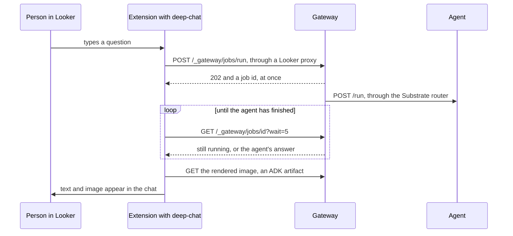

# The chat inside Looker

People talk to the agent from a chat page inside Looker, opened from Looker's **Applications** menu. Looker calls such a page an *extension*: one JavaScript file, kept in a LookML project, that Looker loads into a sandboxed frame.

> [!CAUTION]
> **The bundle has not been built and the extension has not run inside Looker.** It was written without npm and without a Looker to try it in. What could be run was run: the extension's own code against stand-ins (98 tests), and the same code against the real gateway with stand-ins only for Looker's proxies and the agent (15 tests). See [What was tested](#what-was-tested) and [Check these first](#check-these-first).

## What is reused and what is new

The chat is an existing component, not a new one. This folder only connects it.

| Piece | Where it comes from | Changed? |
| :--- | :--- | :--- |
| The chat itself: message list, input box, markdown and tables, inline images, waiting and error states | [deep-chat](https://github.com/OvidijusParsiunas/deep-chat) 2.5.1, MIT, a web component with no framework | No. It is configured through its own properties and `window.remarkable_plugins`. |
| The bridge between the page and Looker | `@looker/extension-sdk` 26.24.0, Looker's own | No |
| The build | webpack, set up like Looker's [`vanilla-javascript` extension template](https://github.com/looker-open-source/create-looker-extension) | |
| The wiring between those and the agent | `src/`, about 1,300 lines of code (1,407 including license headers) | New |

Something that needs no wiring at all, an existing Looker extension that chats with an ADK agent, would have been better. A search of GitHub in November 2026 found none. What was weighed instead of deep-chat:

- **ADK's own web UI in a frame.** No code, but it is a developer tool: it shows traces and can open any user's sessions, and each user's browser would need a direct, authenticated path to the agent.
- **CopilotKit over AG-UI**, which ADK documents. It brings a service of its own that has to run between the page and the agent, and it relies on a streaming connection, which Looker's proxies do not offer.
- **chatscope's chat UI kit.** React components for the look of a chat only: markdown and everything about sending a message would have to be written, which is building a chat.
- **assistant-ui.** Also React, and still at 0.x versions that change quickly, which is not what "stable" asks for.

deep-chat is one custom element, it lets the page supply the function that sends a message, and it renders markdown and images itself. That function is where this folder plugs in.

## How a question travels



An extension has no network access of its own. Every call goes through one of two proxies that Looker provides, and both return a whole response at once, text or JSON only: no streaming, no binary data. A turn that renders a dashboard can take a minute. So the question is handed to the gateway as a *job*, which answers immediately, and the result is collected with short polls. The gateway, not the caller, holds the connection to the agent, so a proxy that gives up on a slow call does not abort the agent's work.

Images arrive as ADK artifacts, as they did on Agent Engine. The extension fetches each one as JSON and shows it inline.

## Build it and put it into Looker

```bash
./deploy.sh extension      # needs Node.js 18+ and npm; touches no cluster
```

This copies this folder to `.work/looker-extension/`, writes the addresses from `config.env` into it, runs `npm install --ignore-scripts` (or `npm ci --ignore-scripts` if a `package-lock.json` is present), the tests and the build, and leaves three files in `.work/looker-extension/lookml/` (`./deploy.sh extension-files` writes the LookML and config files without running npm):

| File | What it is |
| :--- | :--- |
| `bundle.js` | The extension |
| `manifest.lkml` | Declares it to Looker, and lists what it may do: one Looker API method (`me`), the gateway's address, opening a new tab, and (only when `EXTENSION_ALLOW_DOWNLOADS="true"`) saving files |
| `looker_agent.model.lkml` | Looker shows an extension to users of a model in its project. This model exists only for that. |

No Node.js at hand? On GitHub, the repository's "Checks" workflow (Actions tab, started by hand) builds `bundle.js` with the default addresses (pointing at `http://looker-agent-gateway.looker-agent-gateway.svc.cluster.local`) and offers it as a download. That workflow has not been run yet. `manifest.lkml` and the model file come from `./deploy.sh extension-files`, which writes them even where npm is missing.

Then a Looker admin does the following once. `deploy.sh` prints the same list with your values filled in.

1. **Develop > Projects > New LookML Project**, named `looker_agent`, starting point "Blank Project".
2. Add the three files to the project. Put the name of any existing connection into the model file.
3. Configure Git for the project, commit, deploy to production, and allow the model its connection under **Develop > Projects**.
4. **Admin > Users > User Attributes > Create User Attribute**: name `looker_agent_chat_gateway_credential`, type String, user access None, **Hide Values: Yes**, domain allowlist set to the gateway address followed by `/*`. The default value is the chat credential, `user:password` in base64; `deploy.sh` prints the command that produces it.
5. Give people a role whose model set includes `looker_agent`.

The chat then appears under **Applications** as "Looker Agent".

## Two ways for the calls to travel

Set `EXTENSION_TRANSPORT` in `config.env`.

| | `server` (default) | `browser` |
| :--- | :--- | :--- |
| Who calls the gateway | Looker's server, for every call | The user's browser. Looker's server is used once, to trade the password for a 15-minute token. |
| What the gateway needs | Nothing new. It can stay inside the cluster. | An https address that browsers reach and trust: `AGENT_INGRESS_ENABLED`, `AGENT_HOST`, `AGENT_TLS_SECRET` |
| Where the password is | In Looker only | In Looker only. The browser holds the token. |
| Load on Looker's server | While someone waits for an answer, one request at a time, each held for up to five seconds | About one request every 15 minutes per person using the chat |
| What Looker's documentation says | The Extension SDK README: "The server proxy should only be used to get ephemeral access tokens." This transport uses it for more than that. | This is the pattern the documentation shows. |

Start with `server`: it works with what `deploy.sh` installs by default. Move to `browser` if Looker's server refuses the calls, or once more than a handful of people use the chat.

## What the chat does on purpose

- **A link in an answer opens the dashboard, Look or explore as the person who clicked.** By default (`LOOKER_LINK_MODE="plain"`), the agent returns ordinary Looker page URLs (`/dashboards/...`, `/looks/...`, `/explore/...`) and never asks Looker for signed embed URLs. If you set `LOOKER_LINK_MODE="signed"`, signed embed links use `force_logout_login=true`, which Looker's documentation notes would log a signed-in reader out and back in as the embed user. `src/links.js` strictly enforces an allowlist of Looker pages (and unwraps inner signed targets) on this Looker's host name, whatever the port.
- **Markdown images and unexpected links are blocked.** Because `deep-chat` 2.5.1 switches off `remarkable`'s scheme filtering by default, `src/markdown.js` registers a `window.remarkable_plugins` hook (written from reading `deep-chat` 2.5.1 source; not yet run in a browser) that prevents remote markdown `` requests, gates every link through `src/links.js`, and escapes dynamic status/name strings via `markdownLiteral`. Capture-phase `click` and `auxclick` listeners intercept link clicks on the page.
- **Rendered images are type- and size-bounded.** `src/adk.js` and `src/client.js` accept only `image/png` and `image/jpeg` artifacts within configured byte and per-turn artifact caps, with validated artifact path segments.
- **One conversation per page load.** Reloading the page starts a new one. If the agent is replaced or restarted without its memory, the chat starts a new conversation by itself and says so.
- **Answers arrive whole**, not word by word. The proxies cannot stream.
- **One question at a time.** A question asked while another is being answered waits its turn.
- **Text questions only.** No file upload.
- **Links to other sites are off by default.** `allowedLinkOrigins` in `src/config.js` is empty (`[]`), and Looker's `new_window_external_urls` manifest field is omitted unless you set `EXTENSION_ALLOWED_LINK_ORIGINS` in `config.env` (which writes both `src/deployment.js` and `lookml/manifest.lkml`).
- **Errors say what to check**, while `src/markdown.js` strips control/directionality characters and escapes markdown syntax in dynamic values.

Three things about who can see what:

- **The agent answers with the permissions of its own Looker API user, not of the person asking.** Everyone who can open the chat can see what that API user can see. Decide who gets the role in step 5 accordingly, and give the API user a role no wider than theirs.
- **Each Looker user gets their own conversations**, keyed by their Looker user id. The browser sends that id and nothing verifies it. What keeps one person out of another's conversation is that session ids are random and the chat credential cannot list them.
- **The chat has its own gateway credential.** The agent's server is ADK's, which also offers a developer API: other people's sessions, traces, evals. The credential in the user attribute is within reach of every chat user, so the gateway confines it strictly to starting a session under the configured `ADK_APP_NAME`, submitting validated text turns (`{"role": "user", "parts": [{"text": ...}]}`), polling turns it created, fetching validated artifact paths, and requesting short-lived tokens — and refuses any request body that echoes the chat credential. Never put the administrator's credential in Looker.

## Check these first

None of this has been tried. In this order:

1. **The build.** `./deploy.sh extension`. `package.json` names exact versions of `@looker/extension-sdk` and `deep-chat`. Both numbers were read in the projects' repositories, not in the npm registry: if npm cannot find one, put the newest version there instead. If webpack reports an unresolved module, compare `webpack.config.cjs` with Looker's template. After the first good build, keep `package-lock.json` in this folder so later builds use the same versions.
2. **The page loads.** Open the extension. A blank page or an error about `connectExtensionHost` is a loading problem: look at the browser console, and try the other setting of **Admin > Platform > Extension Framework > Enhanced Extension Loading**.
3. **deep-chat inside Looker's sandbox.** It should show a greeting with your first name and an input box. It has not been run inside a sandboxed frame.
4. **The first question.** This is where the transport is tested.
   - "Looker's server could not reach the agent gateway at ..." means Looker refused or failed the call. Check `external_api_urls` in the manifest, then whether Looker's server can resolve and reach the address. If Looker will not call a plain-http in-cluster address (or when running `SECURITY_MODE="strict"`), either enable `INTERNAL_TLS="private-ca"` (`https://looker-agent-gateway.looker-agent-gateway.svc.cluster.local`), or publish the gateway (`AGENT_INGRESS_ENABLED`) and set `EXTENSION_SERVER_GATEWAY_URL` to its https address. Switching to the `browser` transport alone does not help: it also needs Looker's server to reach the gateway once, for the token.
   - "The agent gateway refused the request (HTTP 401)" means the password did not arrive. Check the user attribute's name, value and domain allowlist.
   - "The request to the agent gateway was refused (HTTP 403)" means the caller was recognised and the request refused. If the text continues with "this credential is for the chat only", extension and gateway come from different versions of this kit: run `./deploy.sh gateway` and `./deploy.sh extension` again. Otherwise something in front of the gateway refused it.
5. **A dashboard.** "Show me dashboard 1". The image should appear inline. If the text arrives and the image does not, either the request for the image failed, which the gateway log shows, or the browser refused to display it. The image is handed to the page as a `data:` address; if Looker's content security policy for extensions does not allow that, the browser console says so.
6. **A link.** Click "Open the interactive version in Looker". It should open the dashboard in a new tab and leave you signed in as yourself.
7. **A slow question.** Ask for a large dashboard, one that takes a minute or more to render. The answer should still arrive: the chat asks the gateway every few seconds and gives up after ten minutes (`turnTimeoutSeconds` in `src/config.js`). If it stops earlier with "stopped answering while the agent was working", something on the way is refusing or cutting the polls. The gateway log shows whether they arrive.

## What was tested

`tests/run_local_checks.sh` in the kit runs all of it. Node.js is needed, npm is not.

| What | How | Shows | Does not show |
| :--- | :--- | :--- | :--- |
| `src/` except `index.js` | 98 tests with Node's own test runner (`npm test`). Looker's SDK, the gateway, a `remarkable` renderer instance, and the agent are stand-ins. | Request paths and bodies, reading ADK's events, image type/byte/count limits, safe artifact paths, polling, timeouts, retries, session replacement, both transports, link allowlisting (including `::` LookML ids and unwrapping signed links), `remarkable` plugin rules and `markdownLiteral` escaping, error texts | That the stand-ins behave like the real things |
| The same code against the real gateway | 15 tests (`tests/extension_gateway_test.py`). Only Looker's proxies and the agent are stand-ins. The stand-in for the browser enforces CORS the way a browser does. | That extension and gateway agree with the chat credential over both transports, and that unauthorized routes, malformed `/run` JSON, duplicate keys, LookML `::` edge cases, and credential echoes in bodies are refused before the agent sees them. | Looker's proxies and ADK were imitated from their documentation and source |
| `index.js`, the bundle, `deep-chat` itself | Syntax check only; `window.remarkable_plugins` registration checked against `deep-chat` 2.5.1 source (`remarkableConfig.ts`), not executed in a browser | | Everything that needs a browser, npm or Looker |

## Files

| Path | What it does |
| :--- | :--- |
| `src/index.js` | Starts up inside Looker: connects, asks who the user is, puts the chat on the page |
| `src/chat.js` | Sets deep-chat's properties, installs `markdown.js`'s `remarkable` hook and capture-phase click listeners, and gives it the function that sends a message |
| `src/client.js` | One conversation: session, question, polling, images |
| `src/transport.js` | The two ways through Looker's proxies |
| `src/adk.js` | What ADK's API expects and returns, plus image type/size/segment validation |
| `src/links.js` | Strict Looker page allowlist, signed-link unwrapping, and click/navigation handling |
| `src/markdown.js` | `window.remarkable_plugins` policy blocking remote markdown images and gating links, plus `markdownLiteral` escaping |
| `src/config.js`, `src/deployment.js` | Settings. `deploy.sh` writes `deployment.js` from `config.env` (default gateway URL `http://looker-agent-gateway.looker-agent-gateway.svc.cluster.local`). |
| `test/` | The 98 tests and their stand-ins |
| `package.json`, `webpack.config.cjs` | The build |
